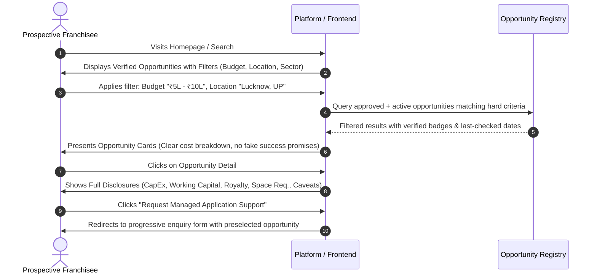
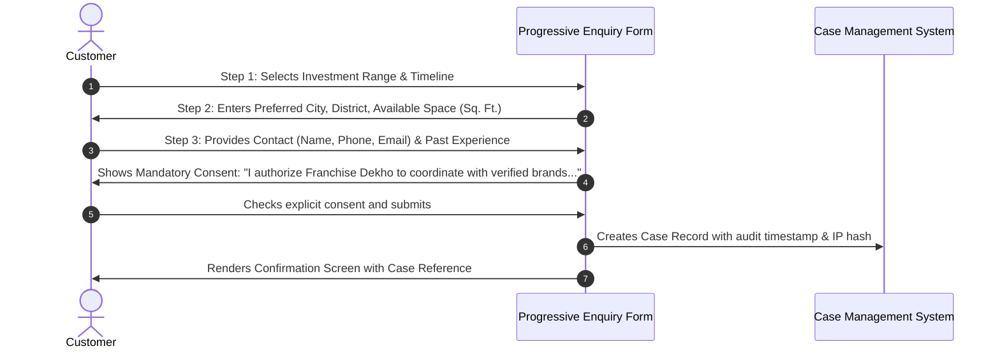
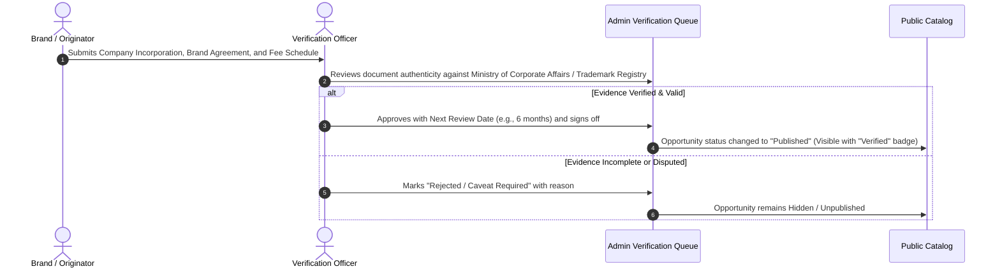

# Sitemap and User Journeys Specification

**Product:** Franchise Dekho (Managed Business-Opportunity Platform)  
**Phase:** MVP Baseline  
**Scope:** Public Discovery, Customer Managed Enquiry, and Verification Operations

---

## 1. Complete MVP Sitemap & URL Structure

```mermaid
flowchart TD
    Home["/ (Homepage)"] --> Explore["/opportunities (Opportunity Directory)"]
    Home --> Sectors["/sectors/:slug (Sector Category Index)"]
    Home --> HowItWorks["/how-it-works (Managed Service & Verification Model)"]
    Home --> Enquiry["/enquiry (Needs Assessment & Assisted Search)"]
    
    Explore --> Detail["/opportunities/:slug (Opportunity Detail & Disclosures)"]
    Sectors --> Detail
    Detail --> EnquiryPrefill["/enquiry?opportunity=:id (Targeted Application Request)"]
    
    Enquiry --> CaseSuccess["/enquiry/confirmed (Confirmation & Next Steps)"]
    
    subgraph Legal & Governance
        Privacy["/privacy-policy"]
        Terms["/terms-of-service"]
        VerificationPolicy["/verification-policy"]
        Grievance["/grievance-and-fraud-reporting"]
    end
    
    subgraph Operations & Verification (Admin Gated)
        AdminLogin["/admin/login"]
        AdminDashboard["/admin/dashboard"]
        AdminVerifications["/admin/verifications (Verification Review Queue)"]
        AdminVerificationDetail["/admin/verifications/:id (Evidence Audit & Action)"]
        AdminCases["/admin/cases (Customer Enquiries & Case Management)"]
        AdminOpportunities["/admin/opportunities (Opportunity Management)"]
    end
```

### 1.1 Public Routes
| Route | Name / Method | Purpose & Content | Access Control |
| :--- | :--- | :--- | :--- |
| `/` | `home` (GET) | Editorial introduction, core search entry, category highlights, verification trust pillars, transparent limitations. | Public |
| `/opportunities` | `opportunities.index` (GET) | Filterable opportunity catalog: budget range, sector, state/city availability, business model. Server-rendered. | Public |
| `/opportunities/{slug}` | `opportunities.show` (GET) | Comprehensive opportunity profile: investment breakdown, infrastructure, territory status, verification facts, last verified date, enquiry CTA. | Public |
| `/sectors/{slug}` | `sectors.show` (GET) | Sector-focused landing page (e.g. Retail, Healthcare, Logistics, Education, CSP/Financial Outlets) with localized context. | Public |
| `/how-it-works` | `pages.how-it-works` (GET) | Clarification of managed-service model vs directories. Explicit disclosure that companies retain approval authority. | Public |
| `/enquiry` | `enquiry.create` (GET/POST) | 3-step progressive needs assessment: budget, location, background, explicit data-sharing consent. | Public |
| `/enquiry/confirmed` | `enquiry.confirmed` (GET) | Confirmation receipt with unique Tracking Reference ID and case manager next steps. | Public (session-gated) |
| `/verification-policy` | `pages.verification-policy` (GET) | Full explanation of audit criteria, evidence requirements, and unpublishing rules. | Public |
| `/grievance-and-fraud` | `pages.grievance` (GET) | Official route to dispute listings, report suspected unauthorized agents or fraud. | Public |

### 1.2 Operations & Administration Routes (Role-gated)
| Route | Name / Method | Purpose & Content | Access Control |
| :--- | :--- | :--- | :--- |
| `/admin/verifications` | `admin.verifications.index` (GET) | Filterable queue of pending company/opportunity audits with freshness alerts and SLA timers. | Verification Officer / Admin |
| `/admin/verifications/{id}` | `admin.verifications.show` (GET) | Side-by-side evidence inspection: legal registration, trademark/brand authorization, territory proof, approve/reject forms. | Verification Officer / Admin |
| `/admin/cases` | `admin.cases.index` (GET) | Customer enquiry pipeline: status progression (New → Shortlist → Consent Recorded → Submitted to Brand → Decision). | Case Manager / Admin |
| `/admin/opportunities` | `admin.opportunities.index` (GET) | CRUD management for opportunities, investment tables, and territory tags. | Admin |

---

## 2. Primary User Journeys

### Journey A: Entrepreneur Discovers & Evaluates an Opportunity


### Journey B: Needs Assessment & Consented Service Request


### Journey C: Verification Officer Audits & Publishes Opportunity


---

## 3. Responsive Breakpoints & Device Strategy

Franchise Dekho prioritizes fast loading and legible scanning on standard Indian mobile smartphones (4G networks):

- **Mobile Viewport (`< 768px`):**
  - Single column linear flow.
  - Sticky bottom action bar on Opportunity Detail (`Enquire Now` + `Download Summary`).
  - Filters collapse into a high-contrast full-screen filter sheet with a clear `Reset` and `Show X Results` button.
  - Table data adapts to key-value disclosure cards to prevent awkward horizontal scroll.
- **Tablet Viewport (`768px - 1023px`):**
  - 2-column grid for listings.
  - Pinned sidebar for search filters.
- **Desktop Viewport (`>= 1024px`):**
  - Max container width: `1200px` centered with comfortable reading gutters (`32px`).
  - Master-detail views for admin queues.
  - Strict 60-75 character line-length limits for editorial paragraphs.
